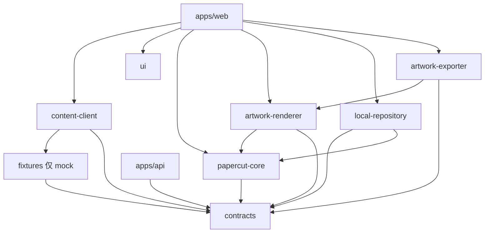

# 模块职责与依赖

公开入口统一 `@shoushang/*`；源码只在包内相对导入，exports 不开放子路径。M01 采用源码 workspace 包供 Vite/esbuild 构建；无需提前构建各包。API 构建打包 contracts，Fastify 外置。包独立发布不是本阶段目标。

图中 renderer→core、exporter→renderer 等是后续允许的方向，尚未实现的包只依赖 contracts。UI 仅可依赖 React 和必要公共类型，不依赖业务包。contracts 仅依赖 Zod，禁止 React/DOM/Fastify；独立无 DOM 检查已配置。fixtures 仅存 DTO，不导入业务包。测试可通过总控根开发依赖取得 fixtures，不能让 contracts 的生产入口反向依赖 fixtures。

| 模块 | 负责 | 不负责 |
| --- | --- | --- |
| contracts | 公共 DTO、单位、错误和接口 | 框架、几何适用性、存储 |
| papercut-core | 对称变换、合法区域、命令状态、历史 | UI、时钟、网络、导出 |
| artwork-renderer | Work→SVG；折叠/展开统一渲染 | 改写 Work、存储或另一套算法 |
| local-repository | IndexedDB 原子写入、revision、迁移、收藏 | 页面逻辑、公开作品发布 |
| artwork-exporter | 共享 SVG→Canvas→不透明 PNG 卡片 | 重写剪纸几何、上传个人作品 |
| content-client | mock/HTTP 内容端口和响应校验 | 数据库直连、凭据暴露 |
| web features | 编排交互与错误提示 | 绕过端口、改共享配置 |
| api | 公开已发布内容、SQLite、服务端权限 | 获取访客本地作品 |

全局路由/样式、启动入口、清单和锁文件、contracts 由总控整合。模块只能改任务列出的目录。后续同一文件有交集必须串行接手，不在多个会话同时写入；M12 和 M13 的 API 子目录隔离，主服务挂载由总控负责。

M01 的 memory 与 mock 是测试实现，不能作为持久化、真实内容、权限或发布的验收证据。未实现业务端点返回 404。M02 技术验证在 prototypes/papercut-verification 隔离，合入正式核心须先评审结果。契约变更记录在 docs/contracts/change-requests.md。

M05：local-repository 只从 papercut-core 公开入口调用正式 Work 校验，读写均不绕过几何校验；它仍不承担 UI、图片渲染或自动保存计时。独立 storage-verification 原型只验证浏览器持久化，正式应用接线留给 M07/M09。
